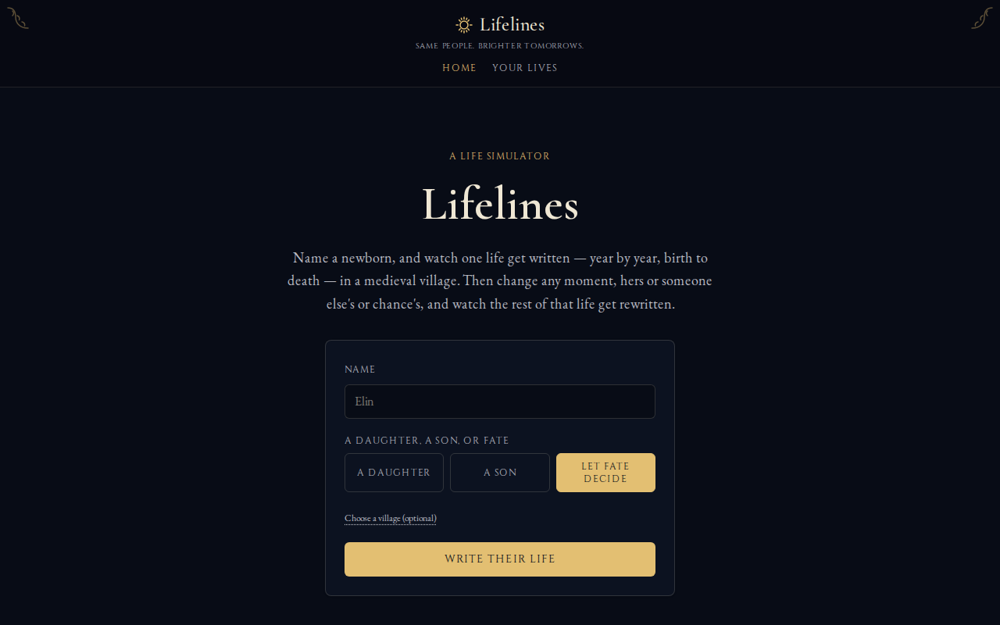
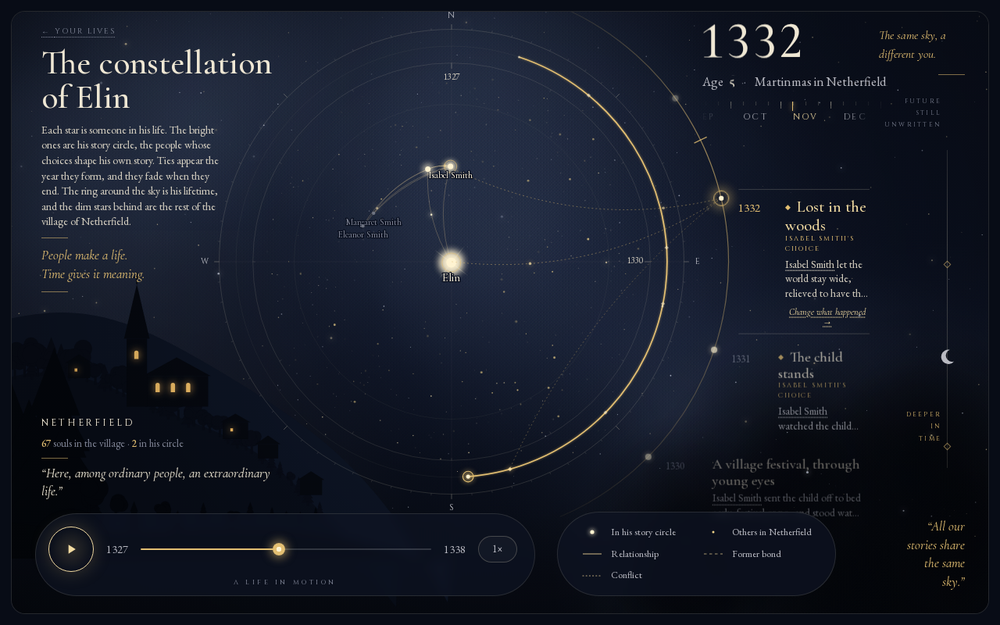
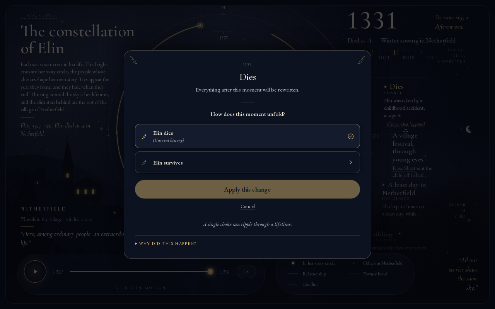

# Lifelines

A life simulator, inspired by Dwarf Fortress's Legends mode. Name a newborn in a medieval
village — a daughter, a son, or let fate decide — and Lifelines writes one whole life, year by
year: births, courtships, work, feuds, illness, deaths. The life lands on a night sky,
**The constellation of `<name>`**, where every star is a person in that life and a reel of years
carries its moments. A moment that was a real decision carries a **"Change what happened →"**
button: choose another option and the rest of the life is rewritten live, in front of you, while
a left-hand panel lets you switch back between **"Original life"** and **"Changed in `<year>`"**.

**Simulate first, then describe.** Prose is never generated by a model. The event log is the
only source of truth; every sentence on screen is rendered from it by a template.

## Concept, in one paragraph

Each simulated year, every living person faces a set of possible life decisions (court, marry,
change work, have a child, feud, reconcile, move away). Biology — aging, fertility, illness,
death — is computed directly from actuarial curves in code. Everything psychological or social
goes through a `DecisionMaker` port that returns a probability distribution over the possible
outcomes; the engine then samples that distribution with a **keyed random number generator**:
`hash(seed, personId, year, decisionKind)`, with one independent Gumbel noise stream per option.
Because no decision shares a sequential stream with another, editing history only changes
outcomes through **state** — a changed input shifts a downstream probability, and an outcome
flips only where the same draw now crosses a different threshold. That is the butterfly effect
this app is built around, and it is also what keeps rewrites reproducible: replay the same
state through the same key and you get the same draw, every time.

## Screenshots







[See the life page on mobile](./docs/screenshots/mobile.png).

## Run it locally

```bash
pnpm install
cp env.example .env.local     # optional: paste a TypeSafe key to let Jev make the decisions
pnpm dev                      # http://localhost:3000
```

**No API key, no network.** With `DECISION_ENGINE=rules` the app runs fully offline: every
decision comes from pure code, and a given seed always produces the same life. Left unset,
`DECISION_ENGINE` picks `jev` when `TYPESAFE_API_KEY` is present and `rules` otherwise, so the
app is always playable.

```bash
pnpm typecheck                # tsc --noEmit
pnpm test                     # vitest run — the full suite, domain and server
pnpm lint                     # eslint
pnpm build                    # next build
```

Lives are persisted in SQLite at `${DATA_DIR}/lifelines.db` (`DATA_DIR` defaults to `.data` for
local dev; the Docker image sets it to `/data`, a mounted volume). A rewritten life is a new
branch in that same file — nothing is thrown away.

### Deploy

`deploy/compose.yaml` runs the app as one container behind Traefik on the shared `coolify`
Docker network; copy `deploy/env.example` to `deploy/.env` and run
`docker compose -f deploy/compose.yaml up -d --build`. See the comments in that file before
changing its memory limits.

## Architecture (hexagonal)

```
src/domain/            Pure TypeScript engine — no Next.js, no SDK imports.
  simulate.ts            the yearly tick loop: gather candidates -> resolve decisions
                         (jev / rules / biology / forced) -> Gumbel-sample -> apply -> record
  legacy-year.ts         one simulated year, extracted unchanged: the reusable annual kernel
  rng.ts                 mulberry32 + keyed streams + Gumbel-max sampling + fragility/surprise
  decisions.ts           the DecisionMaker port + question/distribution/record types
  actuarial.ts           aging / fertility / death curves (pure code, not AI)
  narrate.ts             event -> prose templates, and the deterministic one-paragraph summary
  fork.ts, replay.ts     restore a snapshot, force one option, re-simulate forward
  e-*.ts                 the new lifecycle engine (see "What's next"), created only with
                         `?engine=lifecycle`
  worldgen.ts, mind.ts, hazards.ts, ...    supporting simulation modules

src/adapters/decision/ DecisionMaker adapters: rule-decision-maker.ts (offline, deterministic)
                       and jev-decision-maker.ts (TypeSafe SDK), behind a shared stable-hash cache.

src/server/            Server-only wiring (Node runtime): SQLite (db.ts), the life/branch store
                       (life-store.ts), SSE helpers (sse.ts), abuse guard and rate limits.

src/components/sky/    The night-sky UI: SVG constellation, reel of years, clock-driven player,
                       change modal, rewrite card, person sheet.

src/app/[lang]/        Home, `life/[lifeId]` and `lives`, in en and es.
src/app/api/lives/     Create (streamed), list, read a life, read one person, rewrite (streamed).
```

### Why `DecisionMaker` is a port

`RuleDecisionMaker` is a pure function of the question's state — no network, no randomness of
its own — used by the domain tests and as the default when no API key is configured.
`JevDecisionMaker` asks TypeSafe for the distribution and caches the answer, unmodified, by a
stable hash of `(question id, serialized state)`. A `DecisionMaker` only ever returns a
*distribution*, never an outcome; the engine always does its own sampling. That split is what
makes a rewrite cheap: re-simulating after an edit only pays for calls whose relevant state
actually changed.

## Docs

The design log lives in [`docs/`](./docs), newest first:

- [`docs/decisions.md`](./docs/decisions.md) — what we chose and why, one numbered entry per decision.
- [`docs/findings.md`](./docs/findings.md) — measured results (determinism runs, rules-engine sweeps, timings).
- [`docs/research.md`](./docs/research.md) — prior art that shaped the design.
- [`docs/design/`](./docs/design) — the single-life contract and the night-sky mock and handoff.

## What's next

- **The full-lifetime lifecycle engine.** It exists and runs, but only behind the hidden
  `?engine=lifecycle` flag: a full life takes ~46 s and ~1.5 GB of JS heap, too slow and heavy
  for the default path.
- **Replay versions and journals.** The new lifecycle engine still needs its own closed journal
  and versioned replay before it can replace the default path — see
  [`odd/tasks/narrative-release-execution.md`](./odd/tasks/narrative-release-execution.md).
- **The childhood survival guard.** A guard that makes a child's death rare exists on the parked
  `feat/childhood-survival` branch, but its suite is red and its fixtures need redesign, not
  re-pinning.
- **The test suite's memory.** `pnpm test` peaks around 5 GB of RAM, which is why it is not run
  on small machines.
- **A light theme.** The app is dark only, by design.
- Add a container healthcheck in `deploy/compose.yaml`.
- Make a blank `TYPESAFE_MODEL` fall back to the Jev default.
- Add a generic public-host deploy recipe; the current compose is homelab/Traefik-specific.

### Lifecycle story-quality smoke check

Run `node --import tsx scripts/story-quality.ts` for a deterministic three-year lifecycle
projection in English and Spanish. The JSON labels the source as real (runtime-generated)
and reports repetition, visible earlier-entry cause links, Black Death coverage in each
applicable year, and a small Spanish leak vocabulary separately. A missing link or crisis
entry is a failed check; a crisis outside the observed lifetime is not applicable. These are
heuristics, not comprehensive language detection or a judgment of story quality. Synthetic
50-year recorded-event fixtures and negative controls live in `src/server/story-quality.test.ts`;
they do not simulate 50 years.
